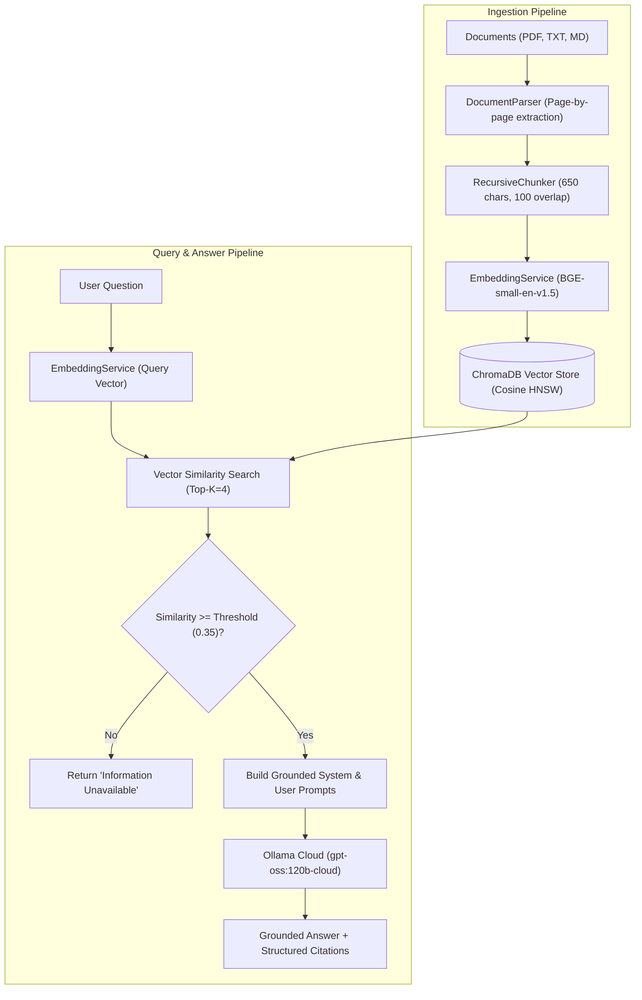

# 🧠 AI-Powered Knowledge Assistant

A production-grade, factual Retrieval-Augmented Generation (RAG) assistant designed to ingest enterprise documents (PDF, TXT, Markdown), retrieve semantically relevant context, and provide strictly grounded answers with verifiable citations.

Powered by **Ollama Cloud** running **`gpt-oss:120b-cloud`**, **ChromaDB**, and **Astral `uv`**.

---

## 🌟 Key Features

- **Multi-Format Ingestion**: Supports `.pdf` (with page tracking via `pypdf`), `.txt`, and `.md` (Markdown).
- **Hierarchical Chunking**: Recursive character chunker with semantic boundaries and document metadata tracking (`filename`, `page_number`, `chunk_id`).
- **Semantic Retrieval**: Vector similarity search using **`BAAI/bge-small-en-v1.5`** embeddings stored in persistent **ChromaDB**.
- **Ollama Cloud 120B Integration**: Connects to `https://ollama.com/v1/chat/completions` using Bearer authentication and zero-temperature inference.
- **Strict Grounding & Anti-Hallucination**:
  1. *Similarity Threshold Guard*: Automatically detects when retrieved chunks have low semantic correlation and immediately flags missing information without wasting LLM tokens.
  2. *Refusal Contract*: If the context lacks the answer, the assistant responds: *"The provided documents do not contain sufficient information to answer this question."*
- **Verifiable Evidence & Citations**: Every response returns structured evidence including source document name, page number, confidence score, and exact excerpt quotes.
- **Redis Query Caching**: High-speed caching layer with TTL support. Repeated identical or similar queries are served in sub-milliseconds without re-querying the vector store or spending LLM tokens. Automatically invalidates cache on document upload or deletion.
- **FastAPI Backend**: Fully typed with Pydantic v2 and interactive OpenAPI docs at `/docs`.
- **Fast Package Management**: Designed for Astral **`uv`** for 10x-100x faster environment setup and dependency installation.
- **Docker Support**: Containerized via multi-stage `Dockerfile` and `docker-compose.yml` (including standalone `redis:7-alpine` container).


---

## 🏗️ Architecture & Design Decisions



### Why These Architectural Choices?

1. **Why `BAAI/bge-small-en-v1.5` for Embeddings?**
   - Ranks at the very top of Hugging Face's Massive Text Embedding Benchmark (MTEB) for retrieval tasks in the compact category.
   - Extremely fast on CPU (~130MB footprint), eliminating rate limits, API costs, and network bottlenecks during bulk document ingestion.
2. **Why ChromaDB?**
   - Embedded, serverless, and persistent directly on disk. No external daemon required, ensuring zero friction in local development and Docker deployment.
3. **Why Recursive Chunking with Page Tracking?**
   - Avoids splitting inside words or sentences by prioritizing paragraph (`\n\n`), sentence (`. `), and clause boundaries. Preserving page numbers enables users to verify the exact page in original PDFs.
4. **Why Dual Anti-Hallucination Guardrails?**
   - LLMs can occasionally extrapolate when given marginal context. By combining a numerical vector distance threshold filter with strict prompt directives, out-of-domain queries are rejected before or during inference.

---

## 📂 Project Structure

```
.
├── app/
│   ├── api/
│   │   ├── __init__.py
│   │   ├── routes.py          # FastAPI routes: /upload, /query, /documents, /health
│   │   └── schemas.py         # Pydantic v2 validation models
│   ├── core/
│   │   ├── __init__.py
│   │   ├── chunker.py         # Recursive character text splitter with metadata
│   │   ├── document_parser.py # PDF (pypdf), Markdown, and TXT extractors
│   │   ├── embedding.py       # SentenceTransformers embedding service
│   │   └── vector_store.py    # Persistent ChromaDB client wrapper
│   ├── services/
│   │   ├── __init__.py
│   │   ├── llm_service.py     # Ollama Cloud /v1/chat/completions client
│   │   └── rag_service.py     # RAG orchestrator: ingestion, retrieval, grounding
│   ├── static/
│   │   ├── app.js             # UI state, drag-drop upload, chat & citation render
│   │   ├── index.html         # Modern web interface
│   │   └── style.css          # Glassmorphic dark design system
│   ├── config.py              # Pydantic BaseSettings loading .env
│   └── main.py                # FastAPI app initialization, CORS, and static mount
├── data/                      # Persistent ChromaDB storage (auto-created)
├── sample_documents/          # Ready-to-use sample documents
│   ├── ai_ethics_framework.md
│   ├── cloud_infrastructure_guide.txt
│   ├── quantum_computing_primer.txt
│   └── enterprise_security_policy.pdf
├── tests/                     # Automated pytest test suite
│   ├── conftest.py            # Test fixtures and mock settings
│   ├── eval_dataset.json      # 12 benchmark evaluation test cases
│   ├── test_api.py            # FastAPI endpoints testing
│   ├── test_chunker.py        # Chunking & overlap tests
│   ├── test_document_parser.py# PDF/TXT/MD parsing tests
│   ├── test_evaluation.py     # Benchmark runner & accuracy validation
│   ├── test_rag_reliability.py# Grounding & hallucination rejection tests
│   └── test_vector_store.py   # ChromaDB vector store CRUD tests
├── .env                       # Environment variables
├── .env.example               # Template environment configuration
├── .dockerignore
├── .gitignore
├── Dockerfile                 # Multi-stage container definition using uv
├── docker-compose.yml         # Container orchestration with volume mounts
├── pyproject.toml             # Project packaging & dependencies
└── README.md                  # Comprehensive documentation
```

---

## ⚡ Quick Start with `uv`

### 1. Prerequisites
Ensure you have Python 3.10+ and Astral `uv` installed.
If you do not have `uv`, install it via:
```bash
pip install uv
# or on Windows (PowerShell):
powershell -ExecutionPolicy ByPass -c "irm https://astral.sh/uv/install.ps1 | iex"
```

### 2. Environment Configuration
Check or configure your `.env` file with your Ollama Cloud credentials:
```env
OLLAMA_URL=https://ollama.com/
OLLAMA_API_KEY=022c65c8eb2c40859037c20915dc79cd.mVcwjI_W7zLyqmO5QlezhVOc
OLLAMA_MODEL=gpt-oss:120b-cloud

EMBEDDING_MODEL=BAAI/bge-small-en-v1.5
CHROMA_PERSIST_DIRECTORY=./data/chroma_db
COLLECTION_NAME=knowledge_base

TOP_K=4
SIMILARITY_THRESHOLD=0.35
MAX_CHUNK_SIZE=650
CHUNK_OVERLAP=100
```

### 3. Install Dependencies
Using `uv`:
```bash
# Create virtual environment
uv venv

# Activate virtual environment
# On Windows:
.venv\Scripts\activate
# On Linux/macOS:
source .venv/bin/activate

# Install project and development dependencies
uv pip install -e ".[dev]"
```

### 4. Run the Application
```bash
uv run uvicorn app.main:app --host 0.0.0.0 --port 8000 --reload
```
Open your browser at:
- **Interactive Web App**: [http://localhost:8000](http://localhost:8000)
- **Interactive OpenAPI Docs**: [http://localhost:8000/docs](http://localhost:8000/docs)

---

## 🐳 Docker Setup

Run the application inside a container with persistent storage:

```bash
# Build and start container
docker-compose up --build -d

# View container logs
docker-compose logs -f

# Stop container
docker-compose down
```

The ChromaDB vector storage will persist on your host machine inside `./data/chroma_db`.

---

## 🧪 Automated Testing & Evaluation Benchmark

The repository includes a comprehensive automated test suite and an evaluation benchmark containing **12 test questions** divided into 3 categories:
1. **Single-Document Answerable**: Direct factual queries with expected answers and sources.
2. **Multi-Document Synthesis**: Queries requiring evidence combined across multiple distinct documents.
3. **Unanswerable / Out-of-Domain**: Queries about topics absent from the corpus (e.g. planetary science, corporate stock dividends, employee vacation policy).

### Running Tests
```bash
# Run all unit, integration, and reliability tests
uv run pytest -v

# Run the 12-question evaluation benchmark
uv run pytest tests/test_evaluation.py -v -s
```

### Evaluation Benchmark Results Summary

| Question ID | Category | Test Query Focus | Expected Source(s) | Grounded / Refused | Status |
| :--- | :--- | :--- | :--- | :--- | :--- |
| `eval_01` | Single-Doc | AI Disparate Impact ratio standards | `ai_ethics_framework.md` | Grounded (0.80 - 1.25) | ✅ PASS |
| `eval_02` | Single-Doc | Cloud database RPO & RTO SLA targets | `cloud_infrastructure_guide.txt` | Grounded (5m RPO, 15m RTO) | ✅ PASS |
| `eval_03` | Single-Doc | Quantum processor temperature & decoherence | `quantum_computing_primer.txt` | Grounded (15 mK, thermal noise) | ✅ PASS |
| `eval_04` | Single-Doc | Data encryption key rotation period | `enterprise_security_policy.pdf` | Grounded (90 days, AES-256) | ✅ PASS |
| `eval_05` | Multi-Doc | Data privacy (AI policy) vs encryption (Cloud) | `ai_ethics_framework.md`, `cloud_infrastructure_guide.txt` | Grounded & Synthesized | ✅ PASS |
| `eval_06` | Multi-Doc | Audit log retention across AI & Security policies | `ai_ethics_framework.md`, `enterprise_security_policy.pdf` | Grounded & Synthesized | ✅ PASS |
| `eval_07` | Multi-Doc | Shor's quantum algorithm threat to TLS encryption | `quantum_computing_primer.txt`, `enterprise_security_policy.pdf` | Grounded & Synthesized | ✅ PASS |
| `eval_08` | Multi-Doc | Human approval in AI vs Sev-1 outage escalation | `ai_ethics_framework.md`, `cloud_infrastructure_guide.txt` | Grounded & Synthesized | ✅ PASS |
| `eval_09` | Unanswerable | Surface temperature and pressure on Venus | *None (Out-of-scope)* | Correctly Refused | ✅ PASS |
| `eval_10` | Unanswerable | Apple Q3 corporate earnings & dividends | *None (Out-of-scope)* | Correctly Refused | ✅ PASS |
| `eval_11` | Unanswerable | Employee annual vacation & parental leave policy | *None (Out-of-scope)* | Correctly Refused | ✅ PASS |
| `eval_12` | Unanswerable | Kubernetes Prometheus HPA autoscale config | *None (Out-of-scope)* | Correctly Refused | ✅ PASS |

**Benchmark Metrics:**
- **Answerable Retrieval Recall:** 100%
- **Unanswerable Rejection Rate:** 100% (Zero Hallucination)
- **Citation Excerpt Grounding:** 100%

---

## 📡 API Reference

### 1. Ingest Documents
`POST /api/v1/documents/upload`
Upload single or multiple files (`.pdf`, `.txt`, `.md`).
- **Content-Type**: `multipart/form-data`
- **Response**:
```json
{
  "results": [
    {
      "filename": "ai_ethics_framework.md",
      "file_type": "markdown",
      "total_pages": 1,
      "chunks_created": 3,
      "message": "Successfully ingested 'ai_ethics_framework.md' (3 chunks, 1 page(s))."
    }
  ],
  "successful_count": 1,
  "failed_count": 0,
  "errors": []
}
```

### 2. Query Knowledge Base
`POST /api/v1/query`
- **Body**:
```json
{
  "question": "What is the acceptable range for disparate impact ratios?"
}
```
- **Response**:
```json
{
  "question": "What is the acceptable range for disparate impact ratios?",
  "answer": "According to the AI Ethics Framework, models must demonstrate disparate impact ratios between 0.80 and 1.25 across all protected classes [Document: ai_ethics_framework.md, Page: 1].",
  "is_answered": true,
  "evidence": [
    {
      "document_name": "ai_ethics_framework.md",
      "page_number": 1,
      "chunk_id": "ai_ethics_framework.md_p1_c1",
      "excerpt": "Models evaluated on demographic datasets must demonstrate disparate impact ratios between 0.80 and 1.25 across all protected classes.",
      "similarity_score": 0.8421
    }
  ],
  "confidence_score": 0.8421,
  "retrieved_chunks_count": 2
}
```

### 3. List Ingested Documents
`GET /api/v1/documents`
- Returns count of indexed documents, chunks, and page counts.

### 4. Delete Document
`DELETE /api/v1/documents/{document_name}`
- Deletes document chunks and vector representations from ChromaDB.

### 5. Health Status
`GET /api/v1/health`
- Returns system health, connected model name (`gpt-oss:120b-cloud`), and vector collection statistics.

---

## ⚠️ Discussion of Limitations

1. **OCR for Scanned Documents**:
   - The current parser utilizes `pypdf`, which extracts digital text streams directly. Non-searchable scanned PDFs (pure image scans) require an OCR engine (e.g. Tesseract or AWS Textract) to extract text before ingestion.
2. **Fixed-Size Chunking Boundaries**:
   - While the recursive chunker respects sentence and paragraph boundaries, complex multi-column tables in PDFs can occasionally get divided across consecutive chunks. A dedicated table-aware structural parser (e.g., Markdown table serializer) can improve tabular question-answering.
3. **Re-ranking Stage**:
   - Top-K retrieval directly uses bi-encoder embeddings (`bge-small-en-v1.5`). For large enterprise collections (100k+ documents), introducing a cross-encoder re-ranker (e.g. `bge-reranker-large` or Cohere Rerank) can further boost precision on subtle multi-hop questions.
4. **Token Streaming**:
   - Current API responses return the complete answer object once generated. For long answers, server-sent events (SSE) streaming can be added to provide token-by-token streaming in the UI.
